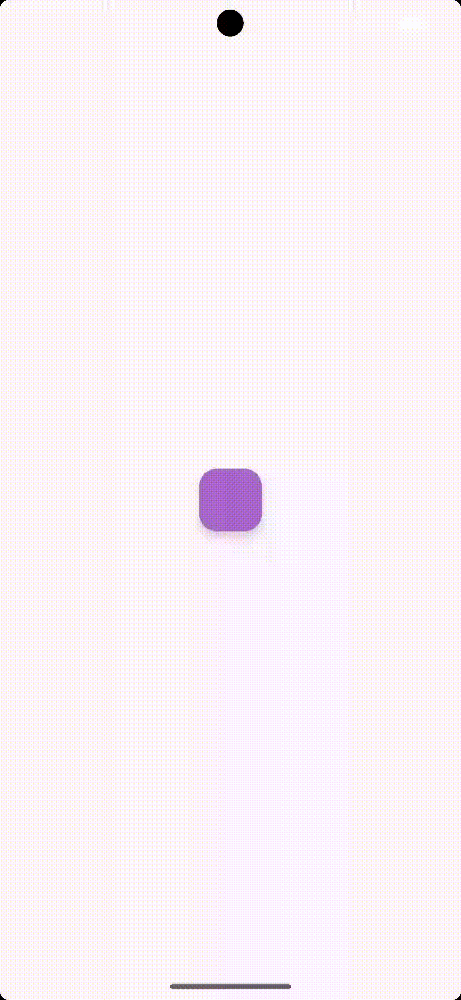

# 🎨 Change Color

<p align="center">
  
</p>

<p align="center">
  A minimal Android app that cycles the screen background through a palette of colors with a single tap.
</p>

<p align="center">
  
  
  
  
  
</p>

---

## 📖 Overview

**Change Color** is a compact, beginner-friendly Android project that demonstrates how to react to a user action and update the UI programmatically. A single `FloatingActionButton` sits in the middle of the screen; each tap applies the next color from a predefined palette to the root layout, looping back to the start after the last color.

It is a good reference for:

- Wiring up a click listener with `findViewById` in Kotlin
- Changing a view's background color at runtime
- Cycling through an array using modulo arithmetic
- Setting up a modern Gradle project (Version Catalog, Kotlin DSL)

## ✨ Features

- 🎯 One-tap interaction with a Material `FloatingActionButton`
- 🌈 Seven-color palette: red, gray, green, magenta, yellow, cyan, blue
- 🔁 Endless loop: after the last color it starts over from the first
- 🌗 Material 3 `DayNight` theme
- 🪶 Tiny codebase: one Activity, one layout, no third-party libraries beyond AndroidX and Material

## 🎬 How It Works

The root `ConstraintLayout` carries the id `view`, and the button is centered inside it. The Activity keeps an array of colors and an index pointing at the next color to apply.

```kotlin
private val colors = arrayOf(
    Color.RED, Color.GRAY, Color.GREEN, Color.MAGENTA,
    Color.YELLOW, Color.CYAN, Color.BLUE
)
private var currentIndex = 0

button.setOnClickListener {
    view.setBackgroundColor(colors[currentIndex])
    currentIndex = (currentIndex + 1) % colors.size   // wrap around at the end
}
```

White and black are intentionally left out of the palette so the screen never blends into the default background or hides the button.

## 🛠 Tech Stack

| Area | Details |
| --- | --- |
| Language | Kotlin |
| UI | XML layouts, `ConstraintLayout`, Material Components (`FloatingActionButton`) |
| Theme | `Theme.Material3.DayNight.NoActionBar` |
| Build system | Gradle 9.4.1 with Kotlin DSL and a Version Catalog (`gradle/libs.versions.toml`) |
| Android Gradle Plugin | 9.2.1 |
| SDK levels | `minSdk` 24 (Android 7.0) · `targetSdk` 36 · `compileSdk` 37 |
| Java compatibility | 11 (Gradle daemon toolchain: JDK 21) |

**Dependencies:** `androidx.core:core-ktx`, `androidx.appcompat`, `androidx.activity:activity-ktx`, `androidx.constraintlayout`, `com.google.android.material`.

## 📁 Project Structure

```text
ChangeColor/
├── app/
│   └── src/
│       └── main/
│           ├── java/com/example/changecolor/
│           │   └── MainActivity.kt        # Click handling and color cycling
│           ├── res/
│           │   ├── layout/activity_main.xml   # ConstraintLayout + FloatingActionButton
│           │   └── values/                    # strings, colors, themes
│           └── AndroidManifest.xml
├── gradle/
│   └── libs.versions.toml                 # Version Catalog
├── screenshots/
│   └── demo.gif                           # Demo shown above
├── build.gradle.kts
├── settings.gradle.kts
└── README.md
```

## 🚀 Getting Started

### Prerequisites

- [Android Studio](https://developer.android.com/studio) (a recent stable release that supports Android Gradle Plugin 9.x)
- Android SDK Platform 37 (installable from the SDK Manager)
- JDK 21 (Android Studio's bundled JDK works; the project can also download one through the Gradle toolchain resolver)
- An Android device or emulator running **Android 7.0 (API 24) or higher**

### Run the app

1. **Clone the repository**

   ```bash
   git clone https://github.com/<your-username>/android-change-color-demo.git
   cd android-change-color-demo
   ```

2. **Open it in Android Studio** via *File → Open*, then select the project folder and wait for the Gradle sync to finish.

3. **Run** the `app` configuration on an emulator or a connected device.

### Build from the command line

```bash
# macOS / Linux
./gradlew assembleDebug

# Windows
gradlew.bat assembleDebug
```

The debug APK is generated at `app/build/outputs/apk/debug/`. To install it straight onto a connected device, use `./gradlew installDebug`.

## 🎛 Customization

Want a different palette? Edit the `colors` array in [`MainActivity.kt`](app/src/main/java/com/example/changecolor/MainActivity.kt). Any `@ColorInt` value works:

```kotlin
private val colors = arrayOf(
    Color.RED,
    Color.parseColor("#FF9800"),   // orange
    Color.parseColor("#4CAF50")    // green
)
```

The button color is set in [`activity_main.xml`](app/src/main/res/layout/activity_main.xml) through `app:backgroundTint`.

## 🧪 Testing

The project ships with the default Android Studio test templates:

```bash
./gradlew test                    # local unit tests
./gradlew connectedAndroidTest    # instrumented tests (needs a device or emulator)
```

## 🗺 Roadmap

- [ ] Random color mode
- [ ] Persist the last selected color across app restarts
- [ ] Smooth animated color transitions
- [ ] Move hard-coded strings (such as the button's content description) into `strings.xml`
- [ ] Migrate the UI to Jetpack Compose

## 🤝 Contributing

Suggestions and improvements are welcome.

1. Fork the repository
2. Create a feature branch: `git checkout -b feature/my-improvement`
3. Commit your changes: `git commit -m "Add my improvement"`
4. Push the branch: `git push origin feature/my-improvement`
5. Open a Pull Request

## 📄 License

This project is licensed under the MIT License. See the [LICENSE](LICENSE) file for details.
